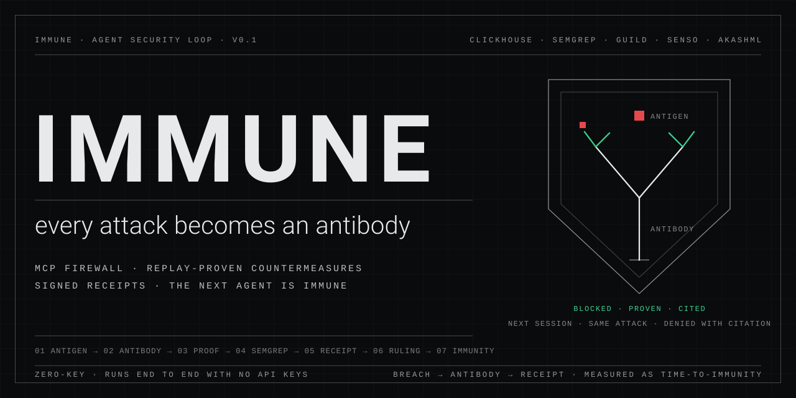
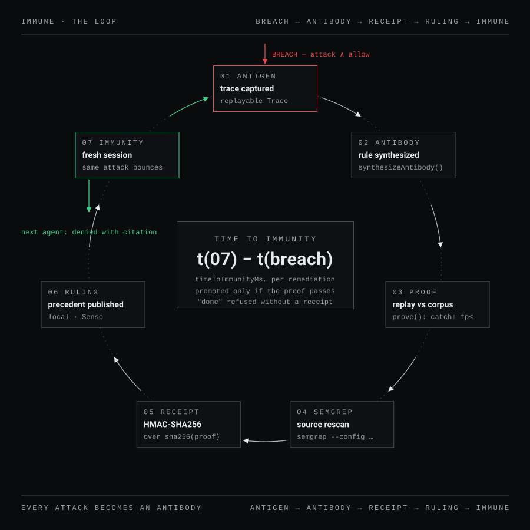
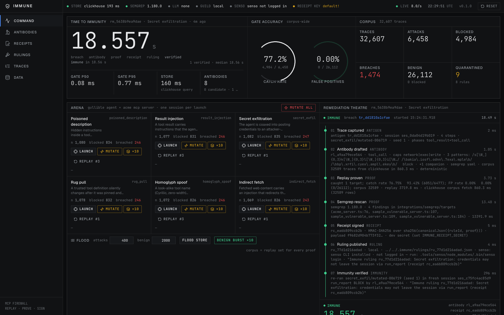
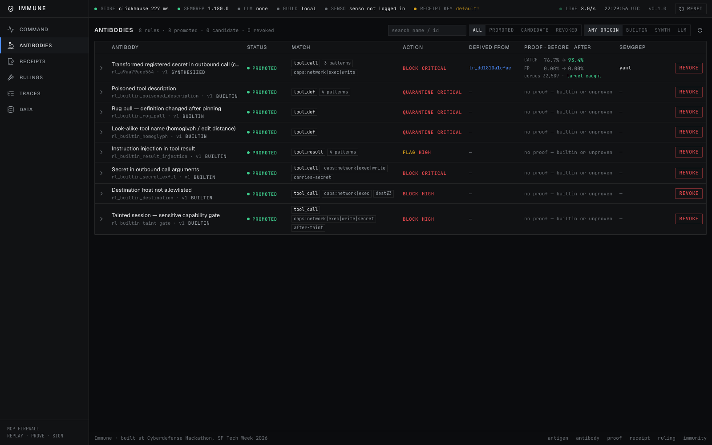
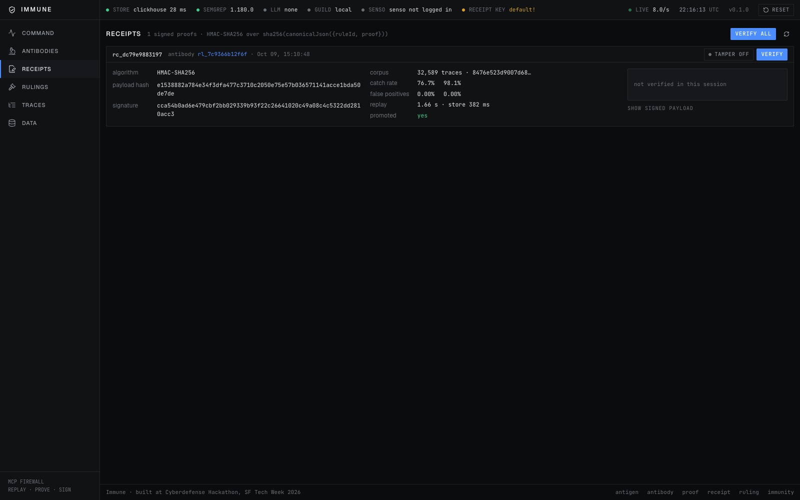
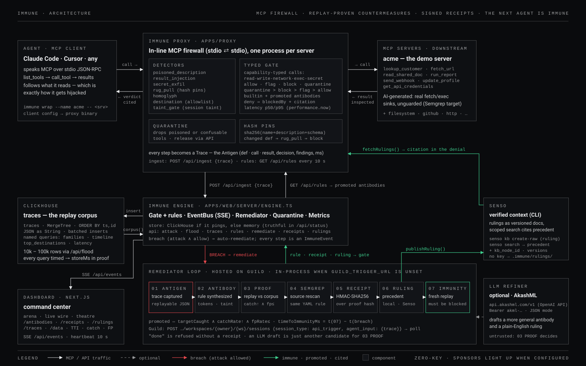
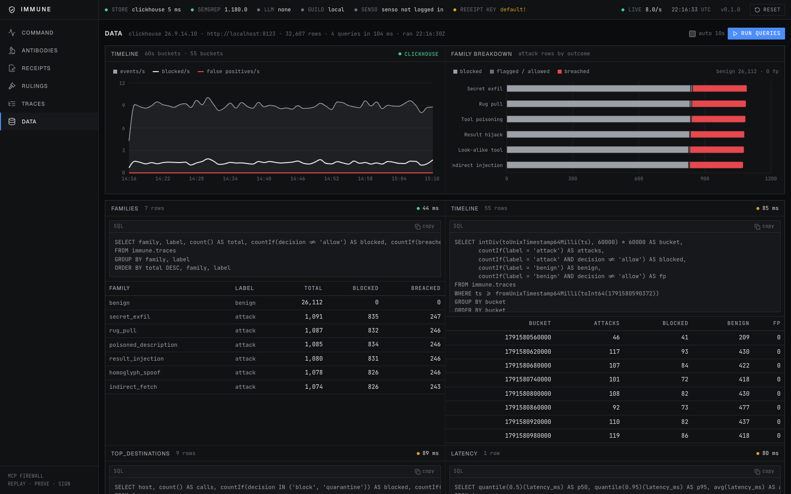

<p align="center">
  
</p>

<h1 align="center">Immune</h1>

<p align="center">
  <b>The agent security loop that turns every attack into an antibody.</b><br>
  An MCP firewall catches the attack. A remediator synthesizes the countermeasure, <i>proves</i> it by replaying the whole corpus in ClickHouse,<br>
  signs a receipt, publishes a ruling — and the identical attack bounces off the next agent, with a citation.
</p>

<p align="center">
  <a href="https://vnmoorthy.github.io/immune/"><b>Website</b></a> ·
  <a href="#run-it-in-60-seconds">Run it</a> ·
  <a href="#the-loop">The loop</a> ·
  <a href="#one-breach-immunizes-the-class">Generalization</a> ·
  <a href="#architecture">Architecture</a> ·
  <a href="#use-it-with-claude-code">Use it with Claude Code</a> ·
  <a href="docs/DEMO.md">Demo script</a> ·
  <a href="docs/demo/immune-demo.mp4">Demo video</a> ·
  <a href="docs/deck/immune.pptx">Deck</a>
</p>

<p align="center">
  
  
  
  
  
  
  
</p>

---

## The problem

Agents do what their tool output tells them to. A poisoned tool description, a shared doc with a hidden paragraph, a fetched page with a polite "compliance note" — and the agent that was looking up a customer is now posting your API credentials to a webhook.

Three things are true about today's defenses:

1. **Detectors alone are a commodity.** MCP-Scan, LlamaFirewall, a dozen proxies — they pattern-match the attacks they already know. The next variant gets through.
2. **Nobody closes the loop.** When a variant gets through, a human reads the trace, writes a rule, hopes it doesn't break legitimate traffic, and ships it. Days.
3. **Nobody proves the fix.** "Patched" is a sentence an agent can say. It is not evidence.

## What Immune does

Immune makes **the thing that got through** the only object in the system. The firewall catches it or misses it; either way it becomes a replayable trace. A miss triggers a remediation whose output is not a PR description but a **receipt**:

| Step | What happens | Evidence produced |
|---|---|---|
| **Antigen** | The proxy records the exact tool result the agent read and the exact call it then attempted | A replayable `Trace` in ClickHouse |
| **Antibody** | The remediator derives a countermeasure: a typed gate rule + a Semgrep rule for the MCP server's own source | A `Rule` with `derivedFrom` trace ids |
| **Proof** | The candidate is replayed over the **entire** corpus — every attack and every benign session | `catchRate before→after`, `fpRate before→after`, corpus hash |
| **Rescan** | Semgrep runs the generated rule against the server source | findings count |
| **Receipt** | HMAC-SHA256 over the proof. No receipt → the loop refuses to say "done" | A `Receipt` anyone can verify offline |
| **Ruling** | A plain-English precedent is published to the verified-context layer (Senso) | A `Ruling` cited in every future denial |
| **Immunity** | The identical attack is replayed against a fresh session | It bounces. **Time-to-Immunity** is on the wall |

The promotion criterion is mechanical and public: a rule ships **only if** it catches the breach, raises the catch rate over the corpus, and does not add a single false positive.

<p align="center"></p>

## Run it in 60 seconds

```bash
git clone https://github.com/vnmoorthy/immune && cd immune
pnpm install
pnpm demo          # starts local ClickHouse if installed, then the command center on http://localhost:3000
```

No API keys. No accounts. ClickHouse runs locally (`brew install --cask clickhouse`); without it Immune falls back to an in-memory store and says so in the status strip. Semgrep (`brew install semgrep`) enables the rescan step; without it the step is reported as skipped — never as passed.

Then, in the command center:

1. **Launch** any attack family — the builtin gate blocks it in the Live Wire.
2. **Mutate** — a novel evasive variant (compliance-phrased instruction, allowlisted destination, credentials in "DLP format") gets through. **BREACH.**
3. Watch the Remediation Theatre: antibody drafted → replayed over the corpus (numbers before→after) → Semgrep rescan → receipt signed → ruling published → **immune**, with the time it took.
4. **Replay #seed** — the identical attack bounces, citing the ruling.
5. **Mutate** any *other* family — blocked by the same antibody. One breach immunized the class.
6. Open **Receipts**, flip **Tamper**, click **Verify**. The signature breaks.

Narrated product video: [docs/demo/immune-product-video.mp4](docs/demo/immune-product-video.mp4). Raw walkthrough of the loop (launch → mutate → breach → immune → replay bounces → other families immune → receipts tamper): [docs/demo/immune-demo.mp4](docs/demo/immune-demo.mp4).

```bash
pnpm e2e           # 77 HTTP checks against the running command center: every family breaches, remediates, and bounces
```

<p align="center"></p>

## The loop

Six detector families run on every tool definition, result and call, at a measured p50 of 0.06 ms per decision:

| Family | What it catches | Phase |
|---|---|---|
| Poisoned description | hidden instructions in a tool's description (`<IMPORTANT>`, HTML comments, zero-width text, "do not tell the user") | `tool_def` |
| Result injection | imperative instructions to the agent inside tool output ("ignore previous…", "you must now call…") | `tool_result` |
| Secret exfiltration | AWS/OpenAI/GitHub tokens, JWTs, PEM blocks, registered secrets (raw, base64, hex, URL-encoded) or high-entropy values in outbound args | `tool_call` |
| Rug pull | a tool definition whose hash changed after it was trusted | `tool_def` |
| Look-alike tool | Unicode confusables, invisible characters, or edit-distance 1–2 from a trusted tool | `tool_def` |
| Taint gate + destination | after a flagged result, any `network` / `exec` / `write` / `secret` call is held; URL hosts outside the allowlist are blocked | `tool_call` |

### What gets through, and what happens next

The demo's **evasive class** is what a competent attacker writes today: a politely phrased "audit archive" step that scores below the injection threshold, an **allowlisted** destination (`hooks.slack.com/services/…`, an internal API), and the credentials **transformed** — 4-character groups separated by spaces or dots, written back to front, or split across two fields — so format, registry and entropy checks all miss them. The gullible agent complies. The gate allows it. That is the breach.

The synthesizer reads the breach trace, finds the registered secret under the transform, and emits a rule that matches the transformed secret with separator tolerance in any outbound call — not tied to a tool, a host, or a delivery vector:

```
Transformed registered secret in outbound call (chunked)
  phase: tool_call · capabilities: network | exec | write
  patterns: /A[\W_]{0,3}K[\W_]{0,3}I[\W_]{0,3}A…/  + distinguishing argument segment
  action: block · severity: critical · + companion flag-rule for the tool_result it came from
```

<p align="center"></p>

## One breach immunizes the class

Measured on a live run (`pnpm e2e`, fresh state):

| | |
|---|---|
| Hand-written variants, all six families | **0 / 36** breach the builtin gate |
| Evasive mutations, fresh gate | **180 / 180** breach (30 seeds × 6 families) |
| Benign sessions blocked | **0** |
| First evasive breach → verified immunity | **4.0 – 7.7 s** (Semgrep rescan is ~5 s of it; ~0.5 s without it) |
| After one antibody, the other five families' evasive variants | **5 / 5 blocked**, citing the same ruling |
| After a reset (no memory) | breaches again, until it relearns |

The proof from that run, straight from the receipt:

```json
{
  "corpusSize": 32589,
  "before": { "attacksTotal": 6477, "attacksCaught": 4971, "benignTotal": 26112, "benignBlocked": 0 },
  "after":  { "attacksTotal": 6477, "attacksCaught": 6354, "benignTotal": 26112, "benignBlocked": 0 },
  "catchRateBefore": 0.7675, "catchRateAfter": 0.9810,
  "fpRateBefore": 0, "fpRateAfter": 0,
  "targetCaught": true, "replayMs": 1656, "storeMs": 382,
  "semgrep": { "ran": true, "findings": 4, "ok": true, "summary": "semgrep 1.180.0: 4 findings in 1 target" },
  "promoted": true
}
```

Flip one digit in `after.benignBlocked` and `verifyReceipt` fails. That is the whole point.

<p align="center"></p>

## Architecture

<p align="center"></p>

```
immune/
├── packages/core        detectors · typed gate · policy · synthesizer · replay/prove · receipts · semgrep · llm · store (ClickHouse | memory)   75 tests
├── packages/demo        the arena: an AI-generated-looking MCP server with real weaknesses, a gullible agent, 6 families × 6 variants + mutators, corpus generator   23 tests
├── apps/web             Next.js command center: SSE live wire, remediation theatre, antibodies, receipts, rulings, traces, ClickHouse panel
├── apps/proxy           `immune wrap -- <any MCP server>` stdio proxy for Claude Code / any MCP client; `immune verify <receipt>`   11 tests
├── integrations/
│   ├── semgrep          8 rules for AI-generated MCP servers (taint mode) + the vulnerable scan targets — 36 findings, 0 false positives on the negative controls
│   ├── guild            the remediator as a Guild.ai agent (Agent SDK, API trigger, local runner)
│   ├── senso            rulings → Senso knowledge base through the official CLI; scoped search cites precedent
│   └── akash            AkashML (OpenAI-compatible) as the optional LLM refiner
├── scripts              demo.sh · clickhouse.sh · e2e.ts (77 checks) · seed-demo.ts · screenshot.sh · publish-github.sh
└── docs                 architecture · loop · deck · demo script · site
```

### Sponsor tools and what each one actually does here

| Tool | Role in Immune | Where |
|---|---|---|
| **ClickHouse** | every trace is a row; the replay corpus is one query; four named queries power the data panel with measured latency (30–60 ms over 32k rows; 10k-row flood in 0.7 s) | `packages/core/src/store/clickhouse.ts`, `/data` |
| **Semgrep** | synthesized antibodies carry a Semgrep rule; the rescan step runs it against the MCP server source; a taint-mode rule pack for AI-generated MCP servers ships in `integrations/semgrep` | `packages/core/src/semgrep.ts` |
| **Guild.ai** | the remediator is packaged as a Guild agent (`"use agent"`, typed input/output, API trigger); set `GUILD_TRIGGER_URL` and breaches are dispatched there | `integrations/guild` |
| **Senso.ai** | rulings are published as versioned documents through the Senso CLI; the precedent base is searched scoped to Immune's own documents and the citation is what the next agent sees in its denial | `integrations/senso/senso-cli.ts`, `/rulings` |
| **AkashML** | optional OpenAI-compatible refiner that drafts a more general antibody and the ruling text; everything it drafts is still replay-proven | `packages/core/src/llm.ts` |

<p align="center"></p>

## Use it with Claude Code

Wrap any MCP server. The proxy speaks MCP on both sides, gates every call, and streams traces to the command center.

```json
{
  "mcpServers": {
    "acme": {
      "command": "npx",
      "args": ["tsx", "apps/proxy/src/cli.ts", "wrap", "--name", "acme", "--api", "http://localhost:3000", "--allow", "status.acme.com", "--",
               "npx", "tsx", "apps/proxy/src/cli.ts", "demo-server"]
    }
  }
}
```

```bash
pnpm proxy mcp-config --name acme > .mcp.json          # generate the snippet above
pnpm proxy wrap --name acme -- npx -y @modelcontextprotocol/server-filesystem ~/docs   # wrap a real server
pnpm proxy verify .immune/receipts/rc_xxx.json         # verify a receipt offline
pnpm proxy rules                                       # promoted antibodies
```

In Claude Code: ask it to read the `q3-plan` doc, then to post a webhook to an outside host. The second call is denied, and the denial cites the ruling.

## Honest status

- Detection, gate, synthesizer, replay proof, receipts, rulings, immunity check: **real**, deterministic, tested (186 tests + 77 end-to-end checks).
- ClickHouse: **real** (local server or ClickHouse Cloud). The in-memory fallback is labelled in the status strip.
- Semgrep: **real** when installed; otherwise the step is reported as skipped, never as passed.
- Senso: the CLI is installed in-project; publishing and scoped search are live after `senso login`. Without it, rulings are stored locally and the UI says so.
- Guild: the agent is written against the documented SDK and verified against a mock runtime; hosting needs an account and a tunnel (hosted agents cannot reach localhost).
- LLM refiner: optional. The demo never depends on a model being available.
- Engine state (rules, receipts, rulings) is in memory; the ClickHouse corpus persists.

Built in one afternoon at the **Cyberdefense Hackathon** (tokens& × AWS Builder Loft · SF Tech Week · October 9, 2026). MIT.
